# Expense Management and Authorization System

---

## System Architecture Diagram (Landscape Format)

```mermaid
graph LR
    %% Styling Definitions for Internal Nodes
    classDef client fill:#2d3748,stroke:#4a5568,stroke-width:2px,color:#fff;
    classDef controller fill:#2b6cb0,stroke:#4a5568,stroke-width:2px,color:#fff;
    classDef logic fill:#2c7a7b,stroke:#4a5568,stroke-width:2px,color:#fff;
    classDef database fill:#d69e2e,stroke:#4a5568,stroke-width:2px,color:#fff;
    classDef logging fill:#e53e3e,stroke:#4a5568,stroke-width:2px,color:#fff;

    %% Tier 1: Client Interfaces (Portal views)
    subgraph Tier_1 [Tier 1: Client Presentation]
        A[Employee Portal<br/>HTML5 / CSS3 / ES6+ JS]:::client
        B[Manager Dashboard<br/>Claims Evaluation Matrix]:::client
    end

    %% Tier 2: Routing, Security & Session Management
    subgraph Tier_2 [Tier 2: API Gateway & Security]
        C[HttpOnly Cookie Guard<br/>XSS Defenses]:::controller
        D[Javalin Router<br/>REST API Controllers]:::controller
        C2[JWT Authentication<br/>Stateless Interceptor]:::controller
    end

    %% Tier 3: Core Domain & Enterprise Service Architecture
    subgraph Tier_3 [Tier 3: Business & Persistence Layer]
        E[Spring Boot Context<br/>Dependency Injection]:::logic
        F[Hibernate ORM Engine<br/>Model Mapping Data Layer]:::logic
        F2[Isolated DAOs<br/>Reimbursement Repositories]:::logic
    end

    %% Tier 4: Storage Infrastructure & Observability
    subgraph Tier_4 [Tier 4: Enterprise Infrastructure]
        G[(PostgreSQL Database<br/>Ledgers & Profiles)]:::database
        H[Log4j Audit Engine<br/>Real-Time Transaction Logs]:::logging
    end

    %% Architectural Relationships & Data Flow
    A -->|Async HTTP Fetch| C
    B -->|Bearer Token Context| C
    C -->|Bearer Credential| C2
    C2 -->|Authorized Context| D
    
    D -->|Injected Payloads| E
    E -->|Domain Operations| F
    F -->|Entity Mapping| F2
    
    F2 -->|CRUD Persistence| G
    
    %% Async Observability Connections
    C2 -.->|Auth Failures 401/403| H
    F2 -.->|Claims Audit Trails| H

    %% Container Contrast Styles (Fixed for visibility)
    style Tier_1 fill:#1a202c,stroke:#4a5568,stroke-width:1px
    style Tier_2 fill:#1a202c,stroke:#4a5568,stroke-width:1px
    style Tier_3 fill:#1a202c,stroke:#4a5568,stroke-width:1px
    style Tier_4 fill:#1a202c,stroke:#4a5568,stroke-width:1px
```



---

A secure, full-stack Java CRUD application that leverages JSON Web Tokens (JWT) to enforce strict backend permission validation and role-based access control. The platform features an employee portal and a dynamic manager dashboard designed to view, filter, approve, and deny pending financial reimbursement claims.

## 🚀 Key Features

* **JWT Stateless Authentication:** Implements secure user login states with signed JSON Web Tokens to eliminate server-side session overhead.
* **Role-Based Authorization:** Validates user permissions directly on the backend to dynamically grant administrative rights to managers.
* **Dynamic Claim Lifecycle:** Enables real-time capabilities to filter, evaluate, approve, or deny pending employee expense reimbursements.
* **Separation of Concerns:** Built upon a clean Model-View-Controller (MVC) architecture backed by isolated Data Access Objects (DAO).

## 🛠️ Tech Stack

### Frontend & Client-Side
* **HTML5 / CSS3:** Structure and responsive styling optimized for employee portal interfaces.
* **JavaScript (ES6+):** Dynamic interface manipulation and asynchronous API handling for seamless claims processing.

### Backend Core & Architecture

| Technology | Role |
| :--- | :--- |
| **Java** | Core enterprise programming language driving the business domain logic. |
| **Spring Boot** | Application framework managing core dependency injection. |
| **Javalin** | Lightweight, high-performance web framework handling REST API routing and service endpoints. |
| **Hibernate** | Enterprise Object-Relational Mapping (ORM) framework bridging the database and DAO layer. |

## 🔒 Security & State Management

To maintain a secure, stateless ecosystem, the frontend handles JWT architecture using modern web application security best practices:
* **Token Storage:** Upon successful authentication via the login endpoint, the issued JWT is securely stored on the client side using **`HttpOnly` Cookies** to shield the application from Cross-Site Scripting (XSS) token theft.
  
* **Authorization Headers:** For all subsequent asynchronous CRUD requests (such as fetching or updating reimbursement claims), the client attaches the token as a bearer credential inside the request context:
* 
  ```http
  Authorization: Bearer <your_json_web_token>
  ```
* **Session Expiration:** The client-side application monitors server responses. If an API endpoint returns a `401 Unauthorized` or `403 Forbidden` status code due to an expired or missing token, the frontend immediately clears the invalid state and routes the user back to the secure portal login screen.

### Security, Data & DevOps
* **JSON Web Tokens (JWT):** Secure, stateless tokens used to handle authorization claims securely across layers.
* **PostgreSQL:** Scalable relational database management system storing employee profile ledgers and claim histories.
* **Gradle:** Automation build tool ensuring predictable dependency trees and application packaging.
* **JUnit & Mockito:** Comprehensive test suite mapping core code paths, mocking layers, and asserting business rules.
* **Log4j:** Active application logging used for real-time audit trailing, transaction tracking, and debugging.

---

## Technical Challenges & Solutions

*   **Challenge: Mitigation of Token Theft and Cross-Site Scripting (XSS) Vulnerabilities**
  
    *   **Problem:** Storing signed JSON Web Tokens (JWT) in standard client-side browser storage (like LocalStorage) exposed corporate authorization keys to script-injection exploits, creating a high risk of administrative privilege hijacking.
    *   **Solution:** Implemented **`HttpOnly` Cookie Storage** architecture to house issued session tokens. By restricting client-side script visibility completely, tokens are automatically injected into transaction contexts by the browser layers, eliminating token extraction pathways and enforcing strong front-of-house security barriers.

*   **Challenge: Domain-Persistence Coupling and SQL Maintenance Overhead**
  
    *   **Problem:** Manually constructing native SQL query blocks inside standard corporate controllers created tight framework coupling, leaving database schemas fragile to modifications and introducing data mapping latency.
    *   **Solution:** Integrated a specialized **Hibernate ORM framework layer** backed by isolated Data Access Objects. This pattern separates entity abstractions from relational mechanics, automating data mutations and query caching pipelines to achieve clean code separation and accelerated execution times.

*   **Challenge: State Consistency and Validation Drift in Stateless API Operations**
  
    *   **Problem:** Transitioning from server-managed user memory environments to stateless systems created verification holes where client requests could submit unauthenticated or stale parameter payloads.
    *   **Solution:** Formed a strict **JWT interceptor gateway tier** across Javalin routing endpoints. Every asynchronous financial command undergoes validation where role rights, user permissions, and timestamps are dynamically validated on the backend server—returning immediate `401 Unauthorized` or `403 Forbidden` barriers to isolate the system from illegitimate transactions.

---

## ⚙️ Getting Started

### Prerequisites
* **Java Development Kit (JDK):** Version 11 or higher.
* **PostgreSQL:** An active local or cloud instance with database user access.

### Installation & Run
1. **Clone the repository:**
   ```bash
   git clone https://github.com
   cd expense-management-system
   ```
2. **Compile and build:**
   ```bash
   ./gradlew build
   ```
3. **Launch the application server:**
   ```bash
   ./gradlew bootRun
   ```

## 📜 License
This project is licensed under the MIT License - see the [LICENSE](LICENSE) file for details.

  
